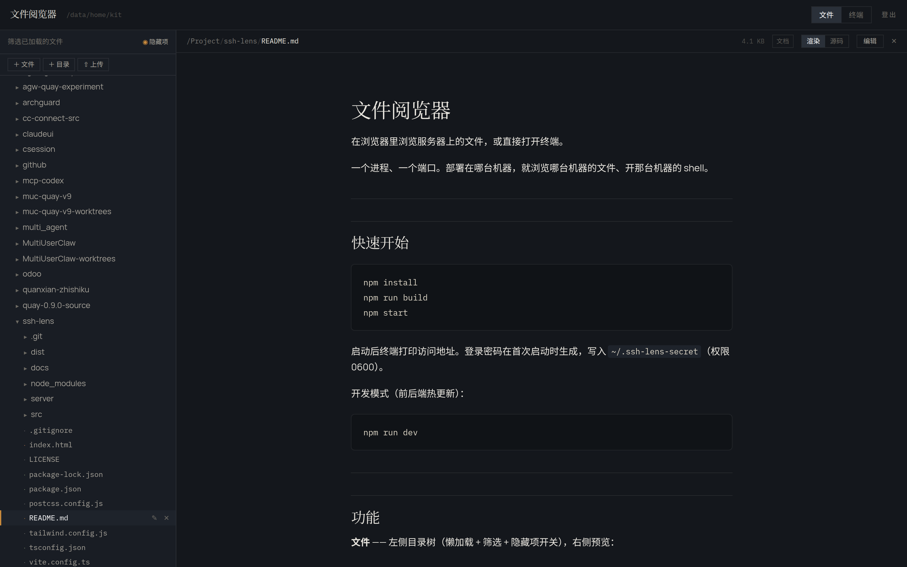
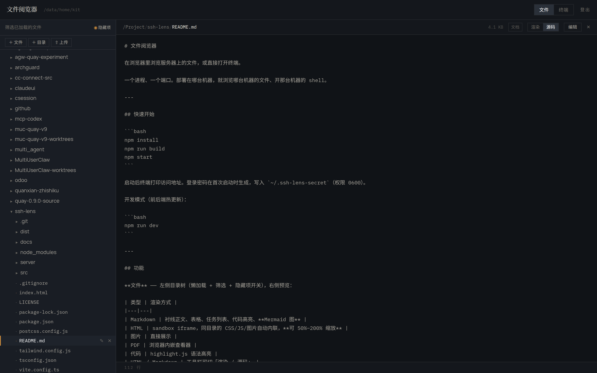
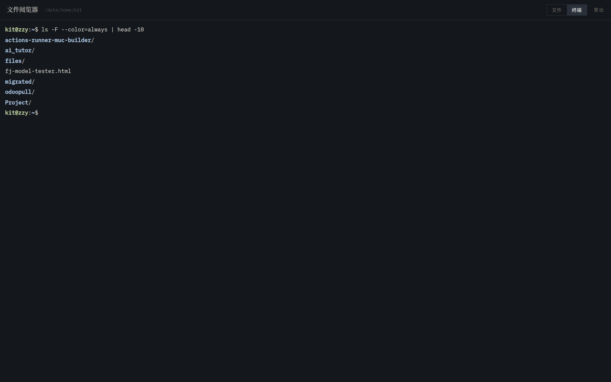

<div align="center">

# SSH Lens · 浏览器里的文件管理器与网页终端

**自托管的 Web 文件管理器 + 在线终端（Web Terminal）。**
在浏览器里浏览服务器文件树、预览 Markdown / HTML / 图片 / PDF、编辑代码，并一键打开交互式 Shell。

**Self-hosted web file manager with a browser terminal** — browse, preview, edit files on your server and open a real shell, all in one page.

[](https://nodejs.org)
[](LICENSE)
[](#技术栈)

[功能](#功能) · [快速开始](#快速开始) · [截图](#截图) · [安全](#安全) · [FAQ](#常见问题)

</div>

---

## 截图



<table>
<tr>
<td width="50%"></td>
<td width="50%"></td>
</tr>
<tr>
<td align="center"><sub>源码视图 · 语法高亮</sub></td>
<td align="center"><sub>网页终端 · xterm.js + node-pty</sub></td>
</tr>
</table>

---

## 为什么是 SSH Lens

SSH 进服务器看个文件，要 `cd`、`ls`、`cat`、`vim` 来回切；想看一眼 Markdown 或图片，终端里根本没有渲染。

SSH Lens 把两件事合成一个页面：**左边文件树，右边预览，右上角切终端**。一个 Node 进程、一个端口，不需要装数据库，不需要 Docker。

适合：

- 想看服务器上某个 Markdown 报告 / HTML 页面 / 日志文件，但不想 `scp` 下载
- 需要在手机上临时看一眼服务器文件
- 想要一个比 `filebrowser` 更轻、自带终端和 Markdown 渲染的自托管文件管理器
- 给内网机器配一个网页版文件浏览器

---

## 功能

### 文件管理器

- 目录树**懒加载**，逐层展开不卡顿
- **服务端递归搜索**文件名，覆盖整棵树（自动跳过 `node_modules`、`.git`）
- 隐藏文件开关（不靠灰色区分，明确切换）
- 新建文件 / 新建目录 / 重命名 / 删除（删除有二次确认）
- **上传文件**，`.zip` 自动解压到同名目录（带 zip slip 防护）
- 上传中文文件名不乱码

### 文件预览

| 文件类型 | 渲染方式 |
|---|---|
| `.md` | 衬线正文、表格、任务列表、代码高亮、**Mermaid 图表** |
| `.html` | sandbox iframe 渲染，同目录 CSS / JS / 图片**自动内联** |
| 图片 | png / jpg / gif / webp / svg / avif 直接显示 |
| PDF | 浏览器内嵌查看器 |
| 代码 | highlight.js 语法高亮（含 `.bashrc`、`Dockerfile`、`Makefile` 等无扩展名文件） |
| 其他 | 二进制 / 超大文件给出说明和下载链接 |

- **渲染 / 源码**一键切换，浏览器 HTML 页面支持 **50%–200% 缩放**
- **GBK / GB2312 编码自动识别**，中文内容不会乱码

### 代码编辑

- 点「编辑」进入 CodeMirror 6 编辑器，带行号、折叠、语法高亮
- 未保存状态有标记，保存失败有错误提示

### 网页终端

- 基于 **xterm.js + node-pty**，真实 PTY，不是命令回显
- 完整 ANSI 颜色、窗口自适应（resize 同步到 PTY）
- **切到文件页再切回来，会话不丢**
- 256 色 / truecolor

---

## 快速开始

```bash
git clone https://github.com/Mason-zy/ssh-lens.git
cd ssh-lens
npm install
npm run build
npm start
```

启动后终端会打印访问地址。登录密码首次启动时生成，写入 `~/.ssh-lens-secret`（权限 0600）。

```
  文件阅览器 已启动
  访问地址  http://127.0.0.1:7788
  可浏览    /data/home/you
  仅本机可访问（设 LENS_HOST=0.0.0.0 开放内网）
```

开发模式（前后端热更新）：

```bash
npm run dev
```

### 环境变量

| 变量 | 默认 | 说明 |
|---|---|---|
| `LENS_HOST` | `127.0.0.1` | 监听地址。设 `0.0.0.0` 让内网访问 |
| `LENS_PORT` | `7788` | 监听端口 |
| `LENS_ROOT` | 用户家目录 | 可浏览的根目录 |
| `LENS_PASSWORD` | 自动生成 | 登录密码 |
| `LENS_SESSION_KEY` | 随机 | 会话签名密钥，不设则重启后登录失效 |
| `LENS_SHELL` | `/bin/bash` | 终端启动的 shell |
| `LENS_SHELL_PASS_ENV` | 未设置 | 设为 `1` 让终端继承含凭据的环境变量 |

---

## 安全

| 层 | 措施 |
|---|---|
| 登录 | 单密码，常量时间比较，5 次/分钟锁定 |
| 会话 | HMAC 签名 httpOnly cookie，SameSite=Strict，7 天 |
| 路径 | 拒绝 `..` 与 NUL 字节，**词法校验 + realpath 解析**，符号链接无法越界 |
| 写入 | 只接受登录态；不能删除根目录；写入上限 2 MB |
| 终端 | WebSocket 握手校验 cookie **和 Origin**（防跨站 WebSocket 劫持） |
| HTML 预览 | sandbox iframe，含 `allow-scripts` 但**不含** `allow-same-origin` |
| raw 端点 | 对 HTML / SVG / JS 下发 `sandbox` CSP，防止同源执行 |
| 终端环境 | 默认过滤含 `KEY`/`TOKEN`/`SECRET`/`PASSWORD` 的变量 |

> ⚠️ **`LENS_ROOT` 是浏览边界，不是安全边界。** 终端拿到的是完整 shell，`cd /` 就能出去。要把访问者真正限制在某个目录，必须不部署终端，或把整个服务放进容器。
>
> ⚠️ **不要直接 `LENS_HOST=0.0.0.0` 暴露到公网。** 密码和 cookie 会明文过网。远程访问请走 SSH 隧道或 Tailscale；确需暴露时前面套一层 TLS 反向代理。

---

## 与其他方案对比

| | SSH Lens | filebrowser | code-server | 纯 SSH |
|---|---|---|---|---|
| 文件树 + 预览 | ✅ | ✅ | ✅ | ❌ |
| Markdown / Mermaid 渲染 | ✅ | ❌ | ✅（编辑器内） | ❌ |
| HTML 渲染 + 相对资源内联 | ✅ | ❌ | ⚠️ | ❌ |
| 网页终端 | ✅ | ⚠️ 需外挂 | ✅ | — |
| 中文编码自动识别 | ✅ | ❌ | ⚠️ | ✅ |
| 单进程、无数据库 | ✅ | ✅ | ✅ | ✅ |
| 体积 | 轻 | 中 | 重 | — |

---

## 常见问题

**Q：和 filebrowser 有什么区别？**
filebrowser 是成熟的文件管理器，功能更多（多用户、分享链接、缩略图）。SSH Lens 更轻，专注「看文件 + 开终端」，额外做了 Markdown/Mermaid 渲染、HTML 相对资源内联、GBK 自动识别。

**Q：能在手机上用吗？**
能。布局是响应式的，窄屏下文件树和预览上下排列。文件树的操作按钮依赖悬停，触摸设备上选中某行后会出现。

**Q：支持多台服务器吗？**
不支持。设计上就是「部署在哪台，看哪台」。要管多台就每台起一个实例，或者前面放个反代。

**Q：为什么不支持编辑 Markdown 时实时预览？**
编辑用 CodeMirror，保存后在「渲染」视图看效果。没有做分屏实时预览，保持简单。

**Q：上传的 zip 会覆盖已有目录吗？**
会写入同名目录，已存在的同名文件会被覆盖。建议先确认再上传。

**Q：终端会话能保持多久？**
只在 WebSocket 连接存活期间。关标签页或刷新就结束。

---

## 技术栈

**后端** — Node.js · Express · `ws` · `node-pty` · `multer` · `adm-zip`
**前端** — React 18 · Vite · TypeScript · Tailwind CSS · CodeMirror 6 · xterm.js · react-markdown · highlight.js · Mermaid

```
server/
  config.ts    根目录、路径校验（词法 + realpath）
  auth.ts      密码、会话 cookie、限流
  files.ts     目录列表、读取、编码识别、HTML 资源内联
  shell.ts     PTY 与 WebSocket 协议
  index.ts     Express 装配、上传、搜索、WebSocket 升级
src/
  App.tsx              顶栏、文件/终端切换
  components/          登录、文件树、预览、编辑器、终端、对话框
  lib/                 API 客户端、语法高亮
```

---

## 关键词

文件管理器 · 网页终端 · 在线文件浏览 · 自托管文件管理 · 服务器文件管理 · Markdown 预览 · Mermaid 渲染 · 代码高亮 · 网页版 SSH · Linux 文件浏览器

self-hosted file manager · web file manager · browser terminal · web terminal · online file browser · file explorer · web IDE · xterm.js · node-pty · markdown viewer · mermaid renderer · code viewer · self-hosted · devtools · file tree

---

## License

[MIT](LICENSE)
